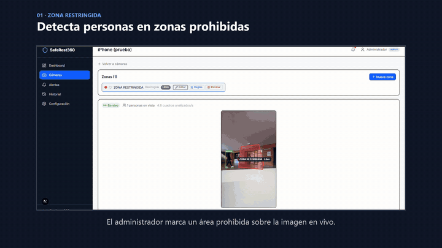

# SafeRest360

**Videovigilancia inteligente para restaurantes.** SafeRest360 convierte las cámaras IP que el negocio ya tiene en un sistema de alertas: detecta personas con visión por computador, aplica reglas por zona y horario, y avisa al administrador por Telegram con la foto del momento.

### Qué hace

- **Zonas restringidas:** alerta cuando alguien permanece en un área prohibida (bodega, cuarto técnico), con un tiempo de confirmación para evitar falsas alarmas.
- **Zonas sin personal:** cuenta regresiva visible y alerta cuando un área clave (caja, barra, cocina) queda sola más tiempo del permitido.
- **Aforo máximo:** alerta cuando una zona supera el número de personas configurado.
- **Monitoreo en vivo:** imagen de cada cámara con las zonas dibujadas y su estado en tiempo real.
- **Centro de alertas:** historial con tipo, gravedad, hora y foto de cada evento.
- **Notificaciones:** Telegram con foto, sin costo por mensaje; WhatsApp como canal opcional.
- **Multiempresa:** cada restaurante accede solo a sus cámaras, zonas, reglas y alertas.

La plataforma detecta presencia de personas, no identidades: no usa reconocimiento facial. Cada alerta es un aviso para revisión; la decisión final la toma una persona.

## Demo



[Ver el video completo de la demo (MP4, 56 s)](docs/demo/SafeRest360_Demo.mp4) · [Presentación del pitch (PDF)](docs/pitch/SafeRest360_Pitch.pdf)

## Arquitectura

Así funciona el prototipo actual:

```
 Cámaras IP (RTSP/RTSPS)
          │  video en vivo
          ▼
┌──────────────────────────────────────────┐        ┌──────────────┐
│ Backend API (FastAPI)                    │        │   Frontend   │
│  ├─ stream_manager: lee cada cámara      │◀──────▶│  (Next.js)   │
│  ├─ Vision Engine: YOLOv8n + ByteTrack   │  REST  └──────────────┘
│  └─ Motor de reglas por zona y horario   │
└───────┬───────────────────────┬──────────┘
        │                       │ alerta con foto
        ▼                       ▼
 SQLite (desarrollo) /     Telegram Bot API
 PostgreSQL (Docker)       (WhatsApp opcional)
```

- La captura de video y la inferencia corren **dentro del proceso del backend** (`backend/app/services/stream_manager.py`), que importa el motor de `vision-engine/`.
- **Pendiente:** separar la inferencia en un equipo local dentro del restaurante (`camera-connector/`) y medir la capacidad con varias cámaras a la vez. Hoy esa carpeta solo tiene la estructura vacía.

## Estructura del proyecto

- `vision-engine/` — Motor de visión artificial: detección con YOLO, seguimiento, reglas por zona, preparación del dataset, entrenamiento y evaluación
- `backend/` — API REST (FastAPI): autenticación, cámaras, zonas, reglas, alertas, lectura de cámaras en vivo y notificaciones
- `frontend/` — Aplicación web (Next.js, TypeScript, Tailwind); ver [`frontend/README.md`](frontend/README.md)
- `camera-connector/` — *Pendiente:* conector local para cámaras IP; hoy la captura la hace el backend
- `infrastructure/` — `docker-compose.yml` con PostgreSQL, Redis, backend, frontend y MLflow
- `tools/` — Simulador de cámaras RTSP con MediaMTX para pruebas sin cámaras reales
- `docs/` — Brief corregido, material del pitch, video de la demo y guía de Telegram
- `colab/` — Notebooks de Google Colab para entrenamiento con GPU

## Inicio rápido

### Backend
```bash
cd backend
pip install -r requirements.txt
cp ../.env.example ../.env
python -m app.main
```

### Frontend
```bash
cd frontend
npm install
npm run dev
```

### Vision Engine (prueba CPU)
```bash
cd vision-engine
pip install -r requirements.txt
pytest tests/ -v
```

### Entrenamiento y evaluación local (CPU)
```bash
cd vision-engine
python -m venv .venv && .venv\Scripts\activate
pip install torch torchvision --index-url https://download.pytorch.org/whl/cpu
pip install ultralytics albumentations "supervision<0.31" shapely lapx rfdetr pycocotools pytest
# descargar COCO val2017 + anotaciones en vision-engine/data/
python train_local.py prepare
python train_local.py train --variants yolov8n --epochs 15 --imgsz 416 --no-offline-aug
python train_local.py evaluate
```
Resultados en `vision-engine/experiments/eval_results.md` (resumen en la sección H del Brief).

### Cámaras en vivo (RTSP)
El backend lee cada cámara activa con URL `rtsp://`/`rtsps://`:
- analiza ~5 cuadros/s con YOLOv8n → ByteTrack → reglas de zona;
- guarda una alerta con foto cuando se cumple una regla;
- muestra la vista en vivo en la página de la cámara.

Los cuadros en vivo solo viven en memoria. Para probar sin cámaras reales, ver [`tools/README.md`](tools/README.md) (MediaMTX + videos con licencia libre).

### Entrenamiento con GPU (Google Colab)
Abrir `colab/SafeRest360_Training.ipynb` en Google Colab con GPU habilitada.

## Instalación en Windows (paso a paso)

Probado en Windows con Python 3.12 y PowerShell. Requiere Node.js 20 o superior. Se necesitan dos terminales: una para el backend y otra para el frontend.

### 1. Backend (terminal 1)
```powershell
cd SafeRest360
copy .env.example .env
cd backend
python -m venv .venv
.venv\Scripts\activate
pip install -r requirements.txt
pip install torch torchvision --index-url https://download.pytorch.org/whl/cpu
pip install ultralytics opencv-python-headless "supervision<0.31" shapely lapx albumentations
python -m app.main
```
El backend usa el motor de visión (`vision-engine`) en el mismo proceso, por eso necesita también OpenCV, Ultralytics y las librerías de seguimiento y zonas. Para correr la aplicación no hacen falta `super-gradients` ni `mlflow`, que solo se usan en experimentos de entrenamiento.

Comprobación: http://localhost:8000/health debe responder `{"status":"ok"}`. La documentación de la API está en http://localhost:8000/docs.

### 2. Frontend (terminal 2)
```powershell
cd SafeRest360\frontend
npm install
npm run dev
```
Abrir la dirección que muestre la terminal (normalmente http://localhost:3000).

### 3. Ingresar
En el primer arranque el backend crea un restaurante y un usuario de demostración:
- Correo: `admin@saferest360.com`
- Contraseña: `admin123`

### Problemas comunes

| Síntoma | Causa | Solución |
|---|---|---|
| `ResolutionImpossible` al instalar `vision-engine/requirements.txt` | `super-gradients` exige `onnxruntime==1.15.0`, que no existe para Python 3.12 | Instalar solo los paquetes del paso 1. `super-gradients` solo se usa para entrenar YOLO-NAS |
| `ModuleNotFoundError: No module named 'cv2'` al iniciar el backend | Falló la instalación anterior y no se instaló OpenCV | Repetir los dos `pip install` del paso 1 con el entorno `.venv` activado |
| `Port 3000 is in use … using available port 3001` y luego "Credenciales inválidas" | Otro programa usa el puerto 3000 y el backend solo acepta peticiones de `localhost:3000` (CORS) | Cerrar el otro programa, o en `.env` poner `CORS_ORIGINS=http://localhost:3000,http://localhost:3001` y reiniciar el backend |
| `.venv\Scripts\activate` no se puede ejecutar | Política de ejecución de PowerShell | `Set-ExecutionPolicy -Scope CurrentUser RemoteSigned` |
| `npm install` muy lento o con archivos bloqueados | OneDrive intenta sincronizar `node_modules` | Clonar el proyecto fuera de OneDrive, por ejemplo en `C:\dev\SafeRest360` |
| Después de 30 minutos la app vuelve al login | El token de acceso expira (`JWT_ACCESS_TOKEN_EXPIRE_MINUTES=30`) | Volver a ingresar |

## Tecnologías

| Componente | Tecnología |
|------------|-----------|
| Frontend | Next.js 16, TypeScript, Tailwind CSS |
| Backend | Python 3.12, FastAPI, SQLAlchemy, Alembic |
| Base de datos | SQLite en desarrollo (predeterminado); PostgreSQL en Docker Compose |
| Cola / caché | Redis incluido en Docker Compose; todavía no se usa en el código |
| Visión artificial | YOLOv8n preentrenado (Ultralytics, AGPL-3.0); RF-DETR (Apache-2.0) evaluado para producción; PyTorch, OpenCV |
| Seguimiento | ByteTrack (via supervision) |
| Experimentación | Registros JSON por experimento + evaluación COCO (pycocotools) |
| Notificaciones | Telegram Bot API (predeterminado, modo simulado por defecto) |
| Infraestructura | Docker Compose (la imagen del backend aún no instala `vision-engine` ni OpenCV; para correr el prototipo completo usar la instalación local) |
| Registro de experimentos | MLflow (opcional, en Docker Compose) y registros JSON en `vision-engine/experiments/` |

## Licencia

Licencia del proyecto por definir. Los componentes de terceros conservan sus propias licencias; en particular, Ultralytics YOLOv8 se distribuye bajo AGPL-3.0, que exige publicar el código de un servicio que lo use o adquirir una licencia comercial de Ultralytics.

## Alertas por Telegram

Configuración del bot, migración de la base existente y prueba controlada:
[Guía de integración](docs/telegram.md).
